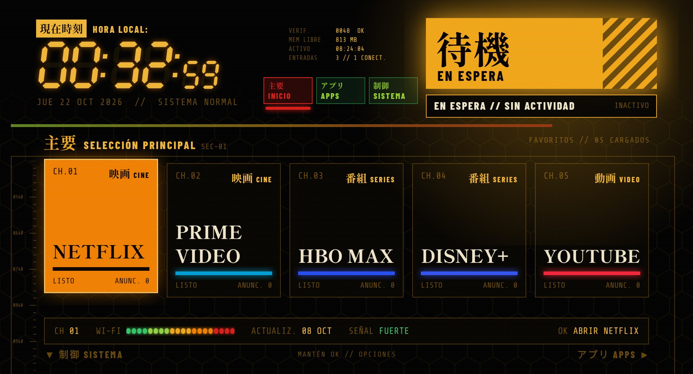
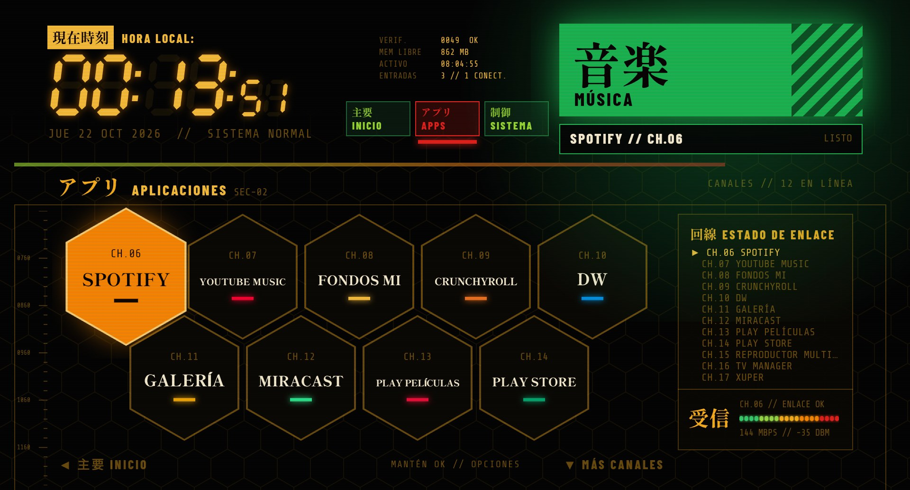
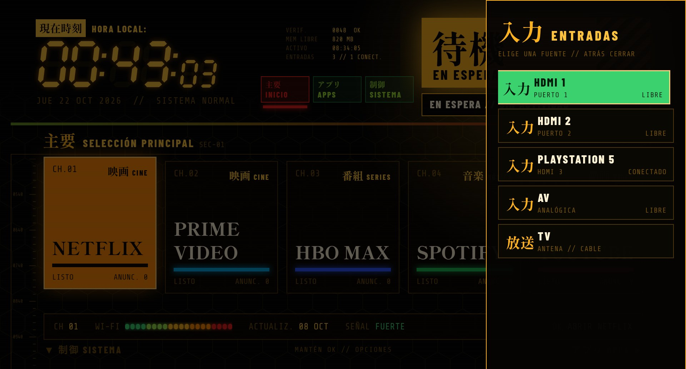

# 起動 KIDŌ — edición en español

Una pantalla de inicio estilo "centro de mando" para Android TV: reloj de siete segmentos, kanji Mincho
grandes, un panal de aplicaciones, lecturas en vivo y un bloque de estado que toma el color de lo que
tienes seleccionado. Sin anuncios, sin filas de recomendaciones y sin acceso a internet.

Esta versión parte de [KIDŌ de Glidian](https://github.com/glidiandev/kido). Tiene la interfaz en
español y suma funciones nuevas: entradas HDMI con el nombre de la consola conectada, un panel de
entradas para el botón Input del control, un panal que se desplaza, reordenar apps con MOVER y
categorías y colores tomados del logo de cada app.
El detalle de cada cambio, en inglés para el autor original, está en [CHANGES.md](CHANGES.md).



**Android TV 8.0+ · ~250 KB · sin permiso de internet · libre y de código abierto (MIT)**

## Qué hay en pantalla

- **主要 INICIO.** Tus cinco apps favoritas como tarjetas grandes, con una barra de datos debajo: canal,
  señal Wi-Fi real, cuándo se actualizó la app y la calidad del enlace.
- **アプリ APLICACIONES (APPS).** El resto de las apps en un panal. Siempre se ven dos filas completas;
  al bajar, el panal se desliza para que ninguna fila quede cortada, y un aviso "▲ ▼ MÁS CANALES"
  indica que hay más. La lista "ESTADO DE ENLACE" de la derecha sigue a la app seleccionada.
- **制御 SISTEMA.** Tus entradas HDMI, Wi-Fi y Ajustes. Si conectas una consola o un reproductor por
  HDMI-CEC, el recuadro muestra su nombre (por ejemplo **PLAYSTATION 5**) y "CONECTADO". Al encender
  algo, aparece el aviso `入力検知 ENTRADA DETECTADA` con el nombre del aparato; OK cambia a esa entrada.
- **El HUD.** Reloj de siete segmentos, bloque de datos en vivo (memoria libre, tiempo activo, entradas),
  pestañas de sección y, abajo, un reloj que avanza cada segundo seguido del registro de lo que haces.
- **Detalles.** Verificación del sistema al encender el TV, secciones que se dibujan al llegar, pantalla
  de arranque al abrir una app, pitidos suaves, cuadrícula hexagonal y líneas de barrido.
- **Movimiento fluido.** Las transiciones arrancan de inmediato y frenan suavemente; el brillo que marca
  la selección viaja en línea recta (también en diagonal) de una app a la siguiente.
- **KIDŌ En espera.** Un protector de pantalla contra el quemado de pantalla.



## Categorías y colores de cada app

KIDŌ reconoce el tipo de cada app y le pone su kanji y su categoría: 映画 CINE, 番組 SERIES,
家族 FAMILIA, 動画 VIDEO, アニメ ANIME, 音楽 MÚSICA, 遊戯 JUEGOS, 店 TIENDA, 再生 REPRODUCTOR,
情報 NOTICIAS, 写真 FOTOS, 映写 PROYECCIÓN, 生放送 TV EN VIVO, 操作 HERRAMIENTAS, 網 NAVEGADOR y
放送 DEPORTES. Las apps conocidas (Netflix, Prime Video, Disney+, YouTube, YouTube Music, Spotify…)
están en un catálogo en `Kido.java`. Las demás se clasifican por palabras de su nombre y paquete, y
después por la categoría que declara la propia app.

El color de la línea bajo el nombre, del brillo y del bloque de estado sale del **logo de la app**: KIDŌ
analiza su banner, agrupa los píxeles de color por tono y elige el más vivo y abundante. Si el logo es
blanco, negro o gris, usa el color de la categoría.

## Panel de entradas y botón Input



En muchos televisores el botón **Input** del control abre el panel de entradas del launcher original.
Si ese launcher está desactivado, el botón deja de hacer algo. KIDŌ trae su propio panel: HDMI (con el
nombre del aparato si el TV lo conoce), AV y TV, y lo abre desde cualquier app con un pequeño ayudante
de accesibilidad que solo atiende ese botón. No lee nada de la pantalla.

**Compromiso a tener en cuenta:** en algunos televisores (comprobado en un Xiaomi Mi TV P1), mientras un
ayudante así está activo, Android deja de repetir el volumen al mantenerlo pulsado: sube un paso por
pulsación. Por eso KIDŌ trae un interruptor: mantén OK sobre **AJUSTES** y elige
**BOTÓN INPUT: SÍ / NO**.

Activarlo por ADB la primera vez:

```
adb shell pm grant dev.glidian.kido android.permission.WRITE_SECURE_SETTINGS
adb shell settings put secure enabled_accessibility_services dev.glidian.kido/dev.glidian.kido.InputKeyService
adb shell settings put secure accessibility_enabled 1
```

El permiso `WRITE_SECURE_SETTINGS` solo sirve para que el interruptor de KIDŌ encienda o apague su propio
ayudante. Sin él, todo lo demás funciona igual.

## Usarlo

| Control                    | Qué hace                                                                                     |
| -------------------------- | -------------------------------------------------------------------------------------------- |
| Flechas                    | Moverse. Arriba desde la primera fila de APPS vuelve a INICIO                                 |
| OK                         | Abrir la app o la entrada                                                                    |
| Mantener OK sobre una app  | **MOVER**, fijar en INICIO, quitar de INICIO o ver la información de la app                  |
| Mantener OK sobre Ajustes  | Sonido, botón Input y tema de color                                                           |
| Atrás                      | Volver a los paneles principales                                                             |
| Home                       | Volver a KIDŌ desde cualquier lugar, una vez que es tu pantalla de inicio                    |
| Input                      | Panel de entradas (si el ayudante está activo)                                               |

### Mover y ordenar apps

1. Mantén OK sobre una app y elige **MOVER**. El menú se cierra y el brillo se pone rojo y parpadea.
2. Con las flechas la app se desplaza y las demás le hacen sitio (arriba y abajo cambian de fila en el panal).
3. Desde la primera fila del panal, **arriba** te lleva a INICIO: con izquierda y derecha eliges cuál de
   los cinco favoritos reemplazar, y la app que sale ocupa el lugar que dejó la que entra.
4. **OK** guarda el nuevo orden y **Atrás** lo cancela. El orden se conserva tras reiniciar el TV.

## Instalar

KIDŌ no está en Play Store: se instala con adb. Necesitas un computador con
[adb](https://developer.android.com/tools/releases/platform-tools) en la misma red que el TV.

1. En el TV, activa las Opciones de desarrollador (Ajustes > Preferencias del dispositivo > Información,
   pulsa OK siete veces sobre **Compilación**) y luego **Depuración USB** o **Depuración por red**.
2. Busca la IP del TV (Ajustes > Red) y conéctate: `adb connect 192.168.1.50:5555`. Acepta el aviso en el TV.
3. Compila e instala:

```
./gradlew assembleDebug
adb install -r app/build/outputs/apk/debug/app-debug.apk
adb shell cmd package set-home-activity dev.glidian.kido/.KidoActivity
```

Si Home sigue abriendo el launcher de fábrica, comprueba primero quién responde a Home y desactiva solo ese:

```
adb shell cmd package query-activities --brief -a android.intent.action.MAIN -c android.intent.category.HOME
# Android TV
adb shell pm disable-user --user 0 com.google.android.tvlauncher
```

En el Xiaomi Mi TV P1 el launcher de Google tiene prioridad fija sobre cualquier otro, así que hay que
desactivarlo. Ese TV también tiene un launcher de pruebas de fábrica (`com.duokan.factorytest`) que
responde a Home: fija KIDŌ como Home **antes** de desactivar el de Google y no abras esa app.

Para limpiar el resto de apps preinstaladas, mira [cleanyourtv](https://github.com/Gathin23/cleanyourtv).

## Desinstalar

Si desactivaste el launcher original, **vuelve a activarlo primero**, o el TV no tendrá nada que mostrar
al pulsar Home:

```
adb shell pm enable com.google.android.tvlauncher
adb shell settings delete secure enabled_accessibility_services
adb uninstall dev.glidian.kido
```

## Privacidad

KIDŌ no tiene permiso de internet, así que no puede enviar nada. Pide `ACCESS_NETWORK_STATE` y
`ACCESS_WIFI_STATE` solo para la señal Wi-Fi de las lecturas, y `WRITE_SECURE_SETTINGS` (opcional,
concedido por ADB) solo para el interruptor del botón Input. El ayudante de accesibilidad solo atiende el
botón Input y no lee el contenido de la pantalla. Tus favoritos, el orden del panal, el tema y el sonido
se quedan en el TV.

## Probado en

| TV                                   | Android       | Notas                                                                                   |
| ------------------------------------ | ------------- | --------------------------------------------------------------------------------------- |
| Sharp AQUOS 4K                       | Android TV 11 | Pruebas del proyecto original                                                           |
| Xiaomi Mi TV P1 (MiTV-MOOQ0, croods) | Android TV 10 | MediaTek m7632, 2 GB. Nombres HDMI-CEC, panel Input (el botón envía `KEYCODE_TV_INPUT`) |

## Compilar desde el código

Necesitas JDK 17 y el SDK de Android (API 34).

```
./gradlew assembleDebug
```

Toda la interfaz se construye en código sobre una cuadrícula de 1920x1080 que se escala a la pantalla
real. Los textos están en español dentro del código (`KidoActivity.java`, `Kido.java`, `KidoDream.java`,
`InputPanelActivity.java`); el catálogo de apps y las reglas de categorías están en `Kido.java`.

## Créditos

- KIDŌ es obra de [Glidian](https://glidian.dev) ([glidiandev/kido](https://github.com/glidiandev/kido)),
  que a su vez partió de [cleanyourtv](https://github.com/Gathin23/cleanyourtv) de Gathin. Gracias.
- Tipografías bajo la SIL Open Font License: [Shippori Mincho B1](https://fonts.google.com/specimen/Shippori+Mincho+B1),
  [Barlow Condensed](https://fonts.google.com/specimen/Barlow+Condensed) y
  [Share Tech Mono](https://fonts.google.com/specimen/Share+Tech+Mono).

Los nombres de las apps pertenecen a sus dueños; KIDŌ solo los usa como etiquetas.

## Licencia

MIT. Ver [LICENSE](LICENSE).
