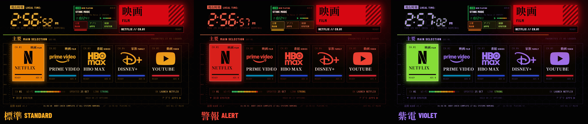

# 起動 KIDŌ

*[Leer en español](README.es.md)*

A command-center home screen for Android TV. A seven-segment clock, big Mincho kanji, a honeycomb of
channels, live readouts and a status block that lights up in the color of whatever you're on. No ads,
no rows of recommendations, no internet access at all.


*Recorded on a Sharp AQUOS 4K TV. KIDŌ (起動) means "start up".*

**Android TV 8.0+ · 404 KB · no internet permission · English and Spanish · free and open source (MIT)**

**Try it in your browser:** [glidian.dev/kido/demo](https://glidian.dev/kido/demo/) (arrow keys and Enter are the remote)

## What's on screen

- **Main panels.** Your five favorite apps as big cards, each with its logo in the theme's color (or just
  the name, if you turn [logos](#themed-emblems) off), and a readout under them: channel, real Wi-Fi
  strength, when the app last updated, and the link quality.
- **Applications.** Every other app as a honeycomb that scrolls by rows, so no hex is ever cut off,
  with a link status panel listing them all.
- **System control.** Your HDMI inputs, Wi-Fi and Settings. If a console or player on HDMI announces
  itself (HDMI-CEC), its box shows the device's name, like `PLAYSTATION 5`. Turn something on and an
  `入力検知 INPUT DETECTED` panel drops in with its name; press OK to switch to it.
- **The HUD.** A seven-segment clock, a live data block (free memory, uptime, inputs), section tabs
  and a footer with a ticking clock and a log of what you've been doing.
- **Now playing (optional).** While music or a show plays, the data block turns into a 音楽 NOW PLAYING
  panel in the app's color: title, artist, a seven-segment elapsed time and a level meter
  (see [below](#now-playing-optional)).
- **Little things.** A system check once per TV boot, sections that trace themselves in as you arrive,
  a launch screen when you open an app, soft console beeps, a faint hex grid and scanlines.
- **Smooth motion.** Moves answer the remote at once and settle softly, and the focus glow travels in a
  straight line from one tile to the next.
- **Keeps itself up to date.** Install or remove an app and KIDŌ rebuilds itself. The clock follows your
  TV's 12 or 24-hour setting.
- **Easy on the eyes.** Nothing flashes quickly: the input alert pulses slowly, and holding an arrow
  moves at a steady pace instead of strobing colors across the screen.
- **KIDŌ Standby.** A screensaver that protects your screen from burn-in (see [below](#screensaver)).

## Your apps, sorted and colored

Every app gets a kanji and a category: 映画 FILM, 番組 SERIES, 家族 FAMILY, 動画 VIDEO, アニメ ANIME,
音楽 MUSIC, 遊戯 GAMES, 店 STORE, 再生 PLAYER, 情報 NEWS, 写真 PHOTOS, 映写 CASTING, 生放送 LIVE TV,
操作 TOOLS, 網 BROWSER and 放送 SPORTS.

Popular apps (Netflix, Prime Video, HBO Max, Disney+, YouTube, Hulu, Paramount+, Apple TV, Plex, Tubi,
Pluto TV, Twitch, Kodi, Sling, YouTube TV, Spotify, Amazon Music, ESPN, Jellyfin, VLC and more) have a
look of their own with their brand color. Anything else is sorted by the words in its name, and its color
comes from its own logo: KIDŌ finds the strongest color in the app's banner. White, black or gray logos
get the category's color.

The manuals, firmware updaters, store demos and setup apps that come with many TVs (Sharp, Google, TCL,
Hisense, Sony, Xiaomi, Philips) are left out of the honeycomb. They're still installed; KIDŌ just doesn't
show them.

## Themes

Three color themes. Hold OK on **Settings** to pick one (and to turn the beeps on or off).




## Screensaver

KIDŌ Standby is a matching screensaver: a big 待機 (standby), the clock and a few live readouts on black.
The whole block glides to a new spot every 20 seconds and sits slightly dimmed, so nothing stays in one
place long enough to burn in. That matters most on OLED TVs.


Turn it on in Settings > Device Preferences > Screen saver > **KIDŌ Standby**. It uses whichever theme
KIDŌ is set to, and the TV starts it after the idle time you set there.

**If your TV hides the Screen saver menu** (some Android TV 12 and newer sets do), turn it on with adb instead:

```bash
adb shell settings put secure screensaver_enabled 1
adb shell settings put secure screensaver_components dev.glidian.kido/dev.glidian.kido.KidoDream
```

The idle time before it starts is usually this setting, in milliseconds (600000 is 10 minutes):

```bash
adb shell settings put system screen_off_timeout 600000
```

To go back to your TV's own screen saver, list the ones it has and set that one the same way:

```bash
adb shell cmd package query-services -a android.service.dreams.DreamService --brief
```

Thanks to [oricerro](https://github.com/oricerro) for testing these on a TCL TV ([#2](https://github.com/glidiandev/kido/issues/2)).

## Using it

| Remote | What it does |
|---|---|
| Arrows | Move around. Left and right run through everything in reading order, from the main panels through the honeycomb to Settings. Up from the honeycomb's first row goes back to the main panels |
| OK | Open the app or input |
| Hold OK on an app | Move it, pin it to the main panels, unpin it, or open its app info. On the app that's playing, also PLAY or PAUSE |
| Hold OK on Settings | Sound on or off, the Input button helper, NOW PLAYING, logos, and the color theme |
| Up from the main panels | The NOW PLAYING panel, when something is playing (OK play/pause, Left/Right track, Down back) |
| Back | Return to the main panels |
| Home | Back to KIDŌ from anywhere, once it's your Home screen |
| Input | The inputs panel, if you've turned on the [Input button helper](#the-input-button-optional) |

### Moving apps

1. Hold OK on an app and choose **MOVE**. Its glow turns red and pulses.
2. The arrows carry it to a new place and the other apps slide over to make room. In the honeycomb, up
   and down change rows.
3. From the honeycomb's first row, **up** takes it to the main panels, and so does **left** past the first
   hex (starting on the last panel): left and right pick which of the five to replace, and the app that
   leaves takes the moved app's place in the honeycomb.
4. **OK** keeps the new order and **Back** cancels. The order is saved on the TV.

## Now playing (optional)

When it's on and an app is playing something (Spotify, YouTube Music, a video app), the data block next to
the clock becomes a NOW PLAYING panel: the title, the artist and the app, how far in you are and the
track's length on a seven-segment display (0:04 / 3:12), a play or pause mark and a small level meter,
all in the app's color. Titles too long to fit scroll slowly, like a car stereo. When nothing
plays, the data block comes back.

To control it, press **Up** from the main panels: the panel lights up like any tile, **OK** plays or
pauses, **Left** and **Right** skip to the previous or next track (when the app allows it), and **Down** or
**Back** take you back. It never grabs focus by itself. Holding OK on the app that's playing, or the
remote's own play/pause button, works too.

It's **off** until you turn it on: hold OK on **Settings** and choose **NOW PLAYING: OFF // TURN ON**.

**What it reads:** only what's playing, the way the TV's own media controls see it: the app, title, artist,
whether it's playing or paused, and how far in it is. Apps can share more (album art, for one), but KIDŌ
doesn't use it. Nothing is saved or sent anywhere.

**The permission:** Android only shares what's playing with apps that have *notification access*. That
access technically lets an app read your notifications too. KIDŌ's listener is an empty shell that never
looks at them; it's only there because Android asks for one.

When you turn NOW PLAYING on, KIDŌ opens the TV's notification access screen if the TV has one. Many
Android TVs hide that screen, so KIDŌ also shows the adb command, which is:

```bash
adb shell cmd notification allow_listener dev.glidian.kido/.NowPlayingListener
```

To turn it off, use the same menu (**NOW PLAYING: ON // TURN OFF**); KIDŌ stops reading right away. To take
the access back as well:

```bash
adb shell cmd notification disallow_listener dev.glidian.kido/.NowPlayingListener
```

## The Input button (optional)

On many TVs the remote's **Input** button opens the stock launcher's inputs panel, so once the stock
launcher is switched off the button stops doing anything. KIDŌ has its own inputs panel (HDMI ports with
device names, AV and TV), and a small helper that opens it from any app when you press Input.

The helper is **off** until you turn it on. It's an accessibility service that only listens for the
Input button: every other key passes straight through, and it can't read anything on screen.

**The trade-off:** while any key-listening helper like this is on, Android stops repeating a held volume
key, so volume goes up or down one step per press instead of running while you hold it. If that bothers
you, switch the helper off again.

To turn it on, give KIDŌ permission to switch its own helper (one time, over adb):

```bash
adb shell pm grant dev.glidian.kido android.permission.WRITE_SECURE_SETTINGS
```

Then hold OK on **Settings** in KIDŌ and choose **INPUT BUTTON: OFF // TURN ON**. The same menu turns it
off. KIDŌ only adds or removes its own helper; any other accessibility services you use are left alone.

To take the permission back (turn the helper off first):

```bash
adb shell pm revoke dev.glidian.kido android.permission.WRITE_SECURE_SETTINGS
```

Without the permission everything else in KIDŌ works the same; only the Input button does nothing.

## Install

> [!NOTE]
> KIDŌ isn't on the Play Store; you install it yourself with adb. It's been tested on two TVs so far
> (see [Tested on](#tested-on)). Other Android TVs should work, but if something looks off on yours,
> please open an issue.

You'll need a computer with [adb](https://developer.android.com/tools/releases/platform-tools) and
the TV on the same network.

1. On the TV, turn on Developer options (Settings > Device Preferences > About, press OK on
   **Build** seven times), then turn on **USB debugging** or **Network debugging** in Developer options.
2. Find the TV's IP address (Settings > Network) and connect:
   ```bash
   adb connect 192.168.1.50:5555
   ```
   Accept the prompt on the TV.
3. Download `kido.apk` from [Releases](../../releases) and install it:
   ```bash
   adb install kido.apk
   ```
   Updating from an earlier version works the same way: `adb install -r kido.apk` keeps your pinned apps
   and settings.

KIDŌ now shows up in your apps. To make it what the Home button opens:

```bash
adb shell cmd package set-home-activity dev.glidian.kido/.KidoActivity
```

Some TVs keep sending Home to the stock launcher anyway. If yours does, switch the stock launcher off
(this doesn't uninstall anything):

```bash
# Android TV
adb shell pm disable-user --user 0 com.google.android.tvlauncher
# Google TV
adb shell pm disable-user --user 0 com.google.android.apps.tv.launcherx
```

> [!IMPORTANT]
> Switching the stock launcher off is safe and easy to undo, but if you ever remove KIDŌ, turn the
> stock launcher back on **first**. See [Uninstall](#uninstall).

> [!TIP]
> Installing another app that can be a Home screen can make the TV forget your choice. If Home stops
> opening KIDŌ, run the `set-home-activity` command above again.

> [!TIP]
> Turn on the [KIDŌ Standby screensaver](#screensaver) too, to protect your screen from burn-in.

## Clean up the rest

If you'd like to clear out the rest of the preinstalled clutter too, take a look at
[cleanyourtv](https://github.com/Gathin23/cleanyourtv), which has tested debloat lists for a lot of TVs.

## Uninstall

> [!WARNING]
> If you switched the stock launcher off, turn it back on **first**. Otherwise the TV is left with
> nothing to show when you press Home.

Turn the stock launcher back on:

```bash
# Android TV
adb shell pm enable com.google.android.tvlauncher
# Google TV
adb shell pm enable com.google.android.apps.tv.launcherx
```

If you turned on the Input button helper, switch it off in KIDŌ's settings menu. Then remove KIDŌ:

```bash
adb uninstall dev.glidian.kido
```

If you picked KIDŌ Standby as the screensaver, choose another one in Settings > Device Preferences >
Screen saver.

## Privacy

KIDŌ has no internet permission, so it can't send anything anywhere. It asks for:

- `ACCESS_NETWORK_STATE` and `ACCESS_WIFI_STATE`, only to read the Wi-Fi signal for the readouts.
- `WRITE_SECURE_SETTINGS`, optional. Android never grants it on its own; you grant it over adb, and
  it's only used to switch KIDŌ's own Input button helper on and off.

The Input button helper only listens for that one button and can't read the screen. If you turn on
[NOW PLAYING](#now-playing-optional), KIDŌ needs notification access to see what's playing; it reads only
the title, artist, app and play state, and never looks at your notifications. Your pinned apps, honeycomb
order, theme and settings stay on the TV.

## Tested on

| TV | Android | Notes |
|---|---|---|
| Sharp AQUOS 4K | Android TV 11 | 1920x1080 interface; about 70 MB of memory in use, less than the stock launcher |
| Xiaomi Mi TV P1 | Android TV 10 | HDMI-CEC device names and the Input button helper (the remote sends `KEYCODE_TV_INPUT`). Tested by Frankdu98 |

KIDŌ needs Android 8.0 or newer. It's laid out for a 16:9 screen and scales to any resolution. If you
run it on another TV, an issue or a pull request adding a row here is very welcome.

## Build from source

You'll need JDK 17 and the Android SDK (API 34).

```bash
./gradlew assembleDebug
adb install -r app/build/outputs/apk/debug/app-debug.apk
```

The whole interface is built in code, on a 1920x1080 grid that scales to the real screen. The words on
screen are in `res/values/strings.xml` (English) and `res/values-es/strings.xml` (Spanish); a new language
is one more `values-xx` folder, as long as each label still fits its slot. The app catalog (names,
categories and brand colors for common apps), the sorting rules for everything else, the first-run
favorites and the hidden system apps are in `Kido.java`.

### Themed emblems

The 28 apps in the catalog have an emblem: a simplified version of the app's logo, drawn in the middle of its
main panel in the theme's color (the honeycomb keeps the names). Prefer the original text-only panels? Hold OK on
Settings and turn **Logos** off. To add an emblem for another app, put a **white emblem on a transparent
background** (no frame or box) in `app/src/main/res/drawable-nodpi/` as `emblem_<name>.png` or `.webp`,
where `<name>` is either the app's short name from the catalog in `Kido.java` (for example
`emblem_netflix.webp`, `emblem_prime_video.webp`) or its package name with dots turned into underscores
(for example `emblem_com_example_app.png`). KIDŌ tints it in the theme's color, so one white image works in
every theme. Apps without an emblem show their name instead.

The emblems are fan-made simplifications of each app's logo. The names and logos belong to their owners, and
KIDŌ isn't affiliated with or endorsed by any of them.

## Credits

- Spanish translation and many v0.2 features (the scrolling honeycomb, smoother motion, logo colors,
  automatic categories, MOVE, HDMI-CEC device names, the inputs panel and the Input button helper) by
  [Frankdu98](https://github.com/Frankdu98). His Spanish edition is at
  [Frankdu98/kido](https://github.com/Frankdu98/kido/tree/espanol).
- KIDŌ started from [cleanyourtv](https://github.com/Gathin23/cleanyourtv) by Gathin, a project for
  stripping the clutter off Android TVs and building your own home screen. Thank you.
- Fonts, all under the SIL Open Font License: [Shippori Mincho B1](https://fonts.google.com/specimen/Shippori+Mincho+B1),
  [Barlow Condensed](https://fonts.google.com/specimen/Barlow+Condensed) and
  [Share Tech Mono](https://fonts.google.com/specimen/Share+Tech+Mono).
- Inspired by the command-center screens of a certain 90s anime about giant robots and very big feelings.

App names belong to their owners; KIDŌ just uses them as labels.

## License

MIT. See [LICENSE](LICENSE).

---

Made by [Glidian](https://glidian.dev).
